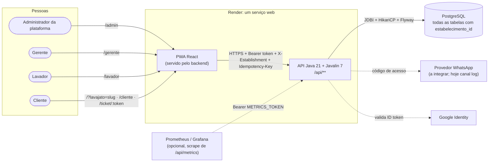

# Washflow: System Design

Sistema de gestão de lava-jatos: uma única instalação (um serviço no Render e um PostgreSQL) atende **vários lava-jatos**. Cada lava-jato tem a própria equipe (gerente e lavadores), os próprios clientes, catálogo, agenda, pátio e caixa. Os dados de um lava-jato nunca aparecem para outro.

> Estado em **04/11/2026** (versão 1.5.1 em `main`; em `develop` já estão PostgreSQL-only, dados de demonstração e as proteções de concorrência e idempotência).
> O dicionário de dados detalhado e as regras de negócio ficam em [CLAUDE.md](../../CLAUDE.md). Estes documentos explicam **como o sistema funciona** e **por quê**.

## Documentos

| Documento | Conteúdo |
|---|---|
| [arquitetura.md](arquitetura.md) | Contexto, containers, camadas do backend e do PWA, caminho de uma requisição, ambientes e deploy |
| [multi-tenant.md](multi-tenant.md) | Como cada requisição fica presa a um lava-jato e as garantias de isolamento |
| [modelo-de-dados.md](modelo-de-dados.md) | Diagrama entidade-relacionamento, índices importantes e migrações |
| [maquina-de-estados.md](maquina-de-estados.md) | Ciclo de vida do atendimento e quem pode mover cada transição |
| [seguranca-e-acesso.md](seguranca-e-acesso.md) | Perfis, formas de login, token, permissões e proteções contra abuso |
| [fluxos.md](fluxos.md) | Diagramas de sequência dos fluxos principais (instalação, logins, entrada, agenda, lavagem, finalização, ticket, venda) |
| [confiabilidade.md](confiabilidade.md) | Concorrência, idempotência, erros e observabilidade (logs, request id, métricas) |
| [api.md](api.md) | Inventário dos endpoints, por área, com perfil exigido e necessidade de lava-jato |
| [../testes-mundo-real.md](../testes-mundo-real.md) | Cenários de concorrência e reenvio testados contra o servidor e resultados |

## Visão em uma página

## Decisões que moldam o sistema

| # | Decisão | Motivo |
|---|---|---|
| 1 | **Multi-tenant em uma única instalação**, com isolamento por `estabelecimento_id` em todas as consultas | Uma instância no Render para todos os clientes; criar um lava-jato novo é um formulário no `/admin`, não um deploy |
| 2 | **Uma única URL**: o lava-jato vem do login (equipe) ou da escolha do cliente (`/?lavajato=slug`, lembrada no aparelho) | Não exige subdomínio nem DNS por cliente |
| 3 | **PostgreSQL em todos os ambientes**; os testes usam PostgreSQL embutido | O comportamento testado é o de produção (travas, índices parciais, `ON CONFLICT`) |
| 4 | **Clean Architecture no backend** (domain → data → infra/presentation → application) | Regras de negócio testáveis sem banco; trocar a persistência não muda os casos de uso |
| 5 | **PWA servido pelo próprio backend**, com atualização por *polling* (3 s no painel do cliente) | Um artefato só para publicar; sem infraestrutura de push |
| 6 | **Transições de status condicionais, capacidade atômica e `Idempotency-Key`** | Clique duplo, reenvio e duas pessoas ao mesmo tempo não duplicam venda, agendamento nem pagamento |
| 7 | **Logs `key=value` com request id e métricas Prometheus** | Investigar um erro relatado pelo usuário a partir do código exibido na tela |

## Linha do tempo das mudanças estruturais

| Versão | Mudança |
|---|---|
| 1.4.0 | Observabilidade: logs por requisição, `X-Request-Id`, `/api/metrics`, erros do navegador (`/api/client-errors`) |
| 1.4.1 | PWA desatualizado corrigido: o shell do app (`index.html`, `sw.js`, manifest) é servido com `no-store` |
| 1.5.0 | Multi-lava-jato: `estabelecimentos`, administrador da plataforma, painel `/admin`, seletor de lava-jato, migrações consolidadas (V1 limpa o esquema antigo, V2 baseline) |
| 1.5.1 | Mensagem clara para telefone sem conta no lava-jato e seletor mais resiliente |
| develop | Somente PostgreSQL (H2 removido), dados de demonstração (`scripts/seed_demo_data.py`), CSV de acessos para QA, proteções de concorrência e idempotência (V3) |
