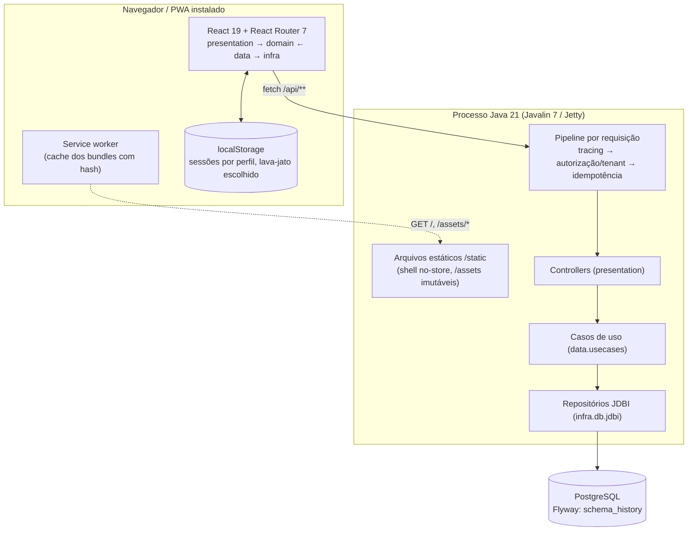
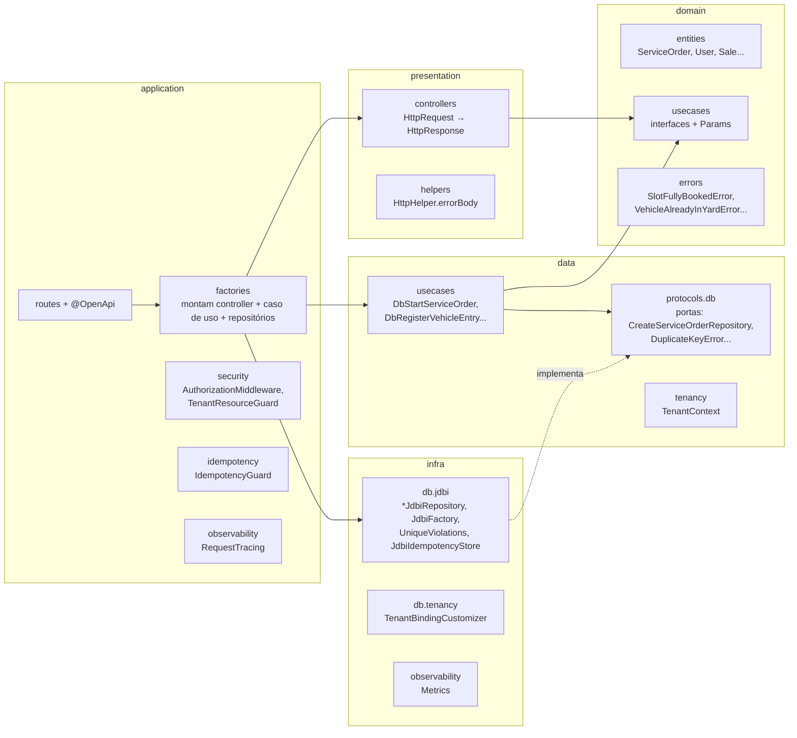
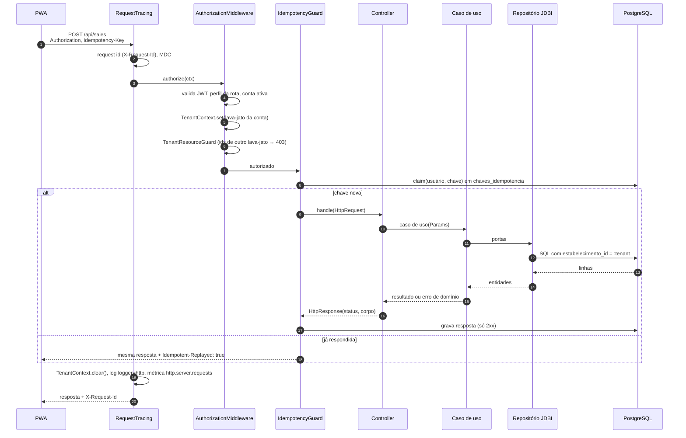
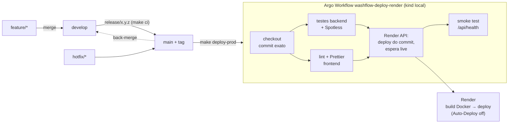

# Arquitetura

## Containers

O backend serve o build do PWA (`web/dist`, copiado para o classpath em `/static` pelo Gradle) e a API em `/api/**`. Qualquer outra rota (`/gerente`, `/ticket/abc`...) cai no `SpaFallbackHandler`, que devolve `index.html` com `200` e `no-store`.

## Backend: camadas (Clean Architecture)

| Pacote | Responsabilidade | Não depende de |
|---|---|---|
| `domain` | Entidades, contratos dos casos de uso e erros de negócio | Nada |
| `data` | Implementa os casos de uso só com portas (`data.protocols`) e o `TenantContext` | JDBI, Javalin, PostgreSQL |
| `infra` | Implementa as portas: JDBI/PostgreSQL, BCrypt, JWT, métricas | Javalin |
| `presentation` | Controllers que convertem `HttpRequest` em chamada de caso de uso e erros em status HTTP | Javalin |
| `validation` | Validações reutilizáveis de corpo de requisição | — |
| `application` | Composição (factories), rotas, segurança, idempotência, tracing, configuração (`AppConfig`) | — |

**Regra prática:** um caso de uso nunca importa JDBI nem Javalin, então é testado com Mockito em milissegundos. As garantias que dependem do banco (índices, travas, `:tenant`) são testadas nos `*IntegrationTest`, em um PostgreSQL embutido (`TestDatabase`).

## Caminho de uma requisição

Qualquer exceção não tratada vira `500` com `{"error", "requestId"}`. Sem lava-jato no contexto, a consulta lança `TenantRequiredError`, que vira `400 "Escolha o lava-jato"`.

## Frontend (PWA)

| Camada (`web/src`) | O que tem |
|---|---|
| `domain` | Modelos e contratos dos casos de uso (ex.: `platform.ts`) |
| `data` | Implementações remotas (`remote-*.ts`) sobre a porta `HttpClient` |
| `infra/http` | `FetchHttpClient`: token do perfil da rota, `X-Establishment`, `Idempotency-Key` nos POSTs autenticados (`idempotent-posts.ts`), código de suporte nas falhas 5xx |
| `presentation/pages` | Telas por ator: `access` (início + seletor), `customer-dashboard`, `washer-app`, `manager-app`, `admin`, `setup`, `ticket` |
| `main` | Rotas (`main.tsx`), factories, sessões (`session/*`), `ErrorReporter` e `ErrorBoundary` |

Rotas do PWA:

| Rota | Quem |
|---|---|
| `/` | Início: escolha do lava-jato, login ou cadastro do cliente, links da equipe |
| `/configurar` | Assistente de primeira instalação (cria o administrador) |
| `/login/admin`, `/admin` | Administrador da plataforma |
| `/login/gerente`, `/gerente/*` | Gerente: pátio, entrada, agenda, venda, caixa, equipe, configurações |
| `/login/lavador`, `/lavador/*` | Lavador (PIN, QR do crachá ou senha): fila e minhas lavagens |
| `/login/cliente`, `/cliente/*`, `/entrar/whatsapp` | Cliente: veículos, agendamento e acompanhamento |
| `/ticket/:token` | Acompanhamento sem login (cliente presencial) |
| `/qrcodes/*` | QR codes para imprimir no balcão |

Sessões ficam no `localStorage`, uma chave por perfil (`washflow:customer-session`, `washer-session`, `manager-session`, `admin-session`). O token enviado é o do perfil da rota atual. O lava-jato escolhido pelo cliente fica em `washflow:establishment`.

## Ambientes e deploy

O deploy de produção é feito pelo Argo Workflows rodando no cluster local (kind). O pipeline repete as verificações do CI e pede ao Render, pela API, o deploy **do commit testado**. Depois espera o status `live` e confere `/api/health`. O Auto-Deploy do Render fica desligado, então um push na `main` sozinho não publica nada. As credenciais ficam no Secret `render-credentials` (ver [infra/README.md](../../infra/README.md)).

| Ambiente | Banco | Configuração |
|---|---|---|
| Local | PostgreSQL do `docker-compose` (Podman). No Windows, `DB_HOST` é o IP da VM do Podman | `.env` (copiado de `.env.example`, ignorado pelo git), `APP_ENV=development` |
| Testes | PostgreSQL embutido (`io.zonky.test:embedded-postgres`), um banco novo e migrado por classe de teste | Nenhuma |
| Produção (Render) | PostgreSQL gerenciado (`DATABASE_URL`) | `APP_ENV=production`, `AUTH_TOKEN_SECRET` (≥ 32), `SETUP_CODE`, `METRICS_TOKEN`, `OTP_CHANNEL`, `GOOGLE_CLIENT_ID`, `APP_PUBLIC_URL` |

- **Startup:** conecta no PostgreSQL (com retentativas). Se não conectar, o app **não sobe**; não existe mais fallback para banco em memória. Depois roda as migrações Flyway e só então aceita requisições.
- **Imagem:** `Dockerfile` em dois estágios (Gradle JDK 21 → Temurin JRE 21 Alpine). O Gradle também compila o PWA (`bun install` + `vite build`).
- **Instância única:** as travas de concorrência ficam no PostgreSQL (`pg_advisory_xact_lock`, índices únicos, `UPDATE` condicional), não na memória da JVM. Por isso o sistema continua correto se um dia rodar com mais de uma instância.

## Stack

| Parte | Tecnologia |
|---|---|
| Backend | Java 21, Javalin 7, JDBI 3.45, HikariCP 7, Flyway 11, Jackson, java-jwt (HS256), BCrypt, Logback, Micrometer/Prometheus, OpenAPI + Swagger (`/swagger`) |
| Banco | PostgreSQL 17 (testes) / gerenciado no Render |
| Frontend | React 19, React Router 7, TypeScript 6, Vite 8, vite-plugin-pwa (Workbox), Vitest 5 |
| Qualidade | JUnit 5 + Mockito, Spotless (google-java-format), ESLint, JaCoCo, SonarCloud (opcional) |
