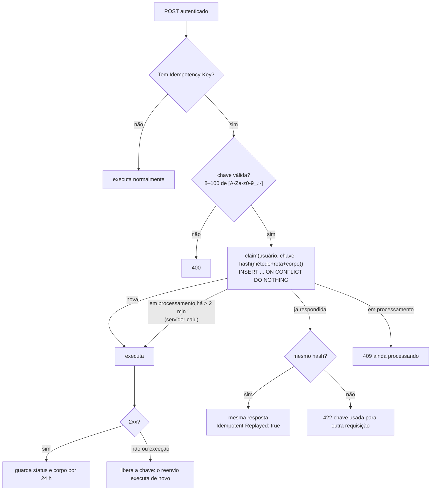

# Confiabilidade: concorrência, idempotência, erros e observabilidade

Na operação real, o gerente clica duas vezes, a rede do celular cai no meio de uma venda e dois lavadores tocam no mesmo carro. O sistema precisa dar a mesma resposta certa em todos esses casos. Os cenários testados e o resultado antes e depois das correções estão em [../testes-mundo-real.md](../testes-mundo-real.md).

## Princípios

1. **A regra fica no banco quando depende de concorrência.** Checar em Java e depois gravar abre uma janela de corrida. Por isso, a checagem e a gravação acontecem juntas: `UPDATE` condicional, índice único ou trava transacional.
2. **Quem perde a corrida recebe 409, nunca 500.** Toda violação de unicidade é traduzida (`UniqueViolations` → `DuplicateKeyError`) e mapeada para um erro de negócio.
3. **Reenviar é seguro.** Toda criação feita por usuário logado aceita uma `Idempotency-Key`, e o PWA sempre envia.
4. **As travas não ficam na memória da JVM.** Ficam todas no PostgreSQL, então o comportamento continua correto com mais de uma instância.

## Mecanismos

| Problema | Mecanismo | Onde |
|---|---|---|
| Dois lavadores iniciam o mesmo carro; concluir ou receber duas vezes | Compare-and-set: `UPDATE ... WHERE id = :id AND status = :expected`. Zero linhas alteradas → `InvalidServiceOrderStatusError` (409) | `ServiceOrderJdbiRepository.updateStatus`, `finalizeSale` |
| Clique duplo em "Receber e finalizar" | Mesmo `UPDATE` condicional + `pagamentos.atendimento_id` único, na mesma transação do pagamento e da comissão | `finalizeSale` |
| Agendamentos simultâneos acima da capacidade | `pg_advisory_xact_lock(hash(lava-jato \| hora))` + contagem + inserção na mesma transação | `createWithinCapacity`, `SchedulingRules.book` |
| Mesma placa registrada de novo com o carro no pátio | Índice único parcial `ux_atendimentos_veiculo_no_patio` → `VehicleAlreadyInYardError` (409) | Migração V3, `DbRegisterVehicleEntry`, `DbCheckInServiceOrder` |
| Cadastro de cliente enviado duas vezes | Índice único de telefone por lava-jato → `DuplicateKeyError` → login na conta recém-criada (com a mesma senha) | `DbAuthenticateUser` |
| Lavador cadastrado duas vezes | Mesmo índice → `PhoneAlreadyRegisteredError` (409) | `DbCreateWasher` |
| Venda, caixa, entrada ou agendamento reenviados | `Idempotency-Key` | `IdempotencyGuard`, `JdbiIdempotencyStore` |
| Setup inicial disputado | Criação do administrador numa transação com trava, uma única vez | `DbSetupEstablishment` |
| Ticket e crachá gerados de novo | O ticket devolve o mesmo token; o crachá novo invalida o anterior | `AccessFactory` |

## Idempotency-Key

- **Escopo:** por usuário (o mesmo valor de chave de outro usuário é outra operação). Vale para todo `POST` autenticado que traz o cabeçalho. Requisições sem o cabeçalho funcionam como antes.
- **No PWA** (`web/src/infra/http/idempotent-posts.ts`):
  - Todo POST autenticado recebe uma chave (`crypto.randomUUID()`).
  - Uma requisição idêntica (mesma sessão, URL e corpo) que ainda está em andamento não é enviada de novo: as duas chamadas compartilham a mesma resposta.
  - Se a requisição falha, a chave é mantida, e reenviar o mesmo conteúdo reaproveita a chave.
  - Depois de um sucesso, a chave é descartada, e a próxima operação igual é uma operação nova.
- **Limpeza:** chaves com mais de 24 h são apagadas a cada novo claim (índice em `criado_em`).

## Erros

| Situação | Status | Corpo |
|---|---|---|
| Validação (placa, telefone, valores, períodos) | 400 | `{"error": "mensagem em português"}` |
| Sem lava-jato | 400 | "Escolha o lava-jato" |
| Sem token, token inválido ou expirado, conta inativa | 401 | |
| Perfil sem permissão, recurso de outra conta ou de outro lava-jato | 403 | |
| Recurso inexistente, lava-jato inexistente ou suspenso | 404 | |
| Status inesperado, corrida perdida, horário lotado, placa no pátio, telefone/e-mail em uso, chave em processamento | 409 | |
| Idempotency-Key reutilizada com outro conteúdo | 422 | |
| Erro inesperado | 500 | `{"error": "Internal server error", "requestId": "..."}`; o PWA mostra "informe o código ..." |

Todo erro tem `requestId`, e a mensagem vai também para o log (`reason="..."`).

## Observabilidade

| Sinal | Como |
|---|---|
| **Log de acesso** | Uma linha `logger=http` por requisição (UTC, `key=value`): `request_id`, método, rota (template), path, status, `duration_ms`, usuário/perfil, IP e `reason` nos erros. 2xx/3xx em INFO, 4xx em WARN, 5xx em ERROR com stack trace. `/api/health` e `/api/metrics` só aparecem em DEBUG |
| **Request id** | `X-Request-Id` aceito de entrada (8–64 caracteres seguros) ou gerado. Devolvido no cabeçalho e no corpo dos erros |
| **Métricas** | `GET /api/metrics` (Prometheus, `Bearer METRICS_TOKEN`): `http_server_requests_seconds_*` por método, rota, status e resultado; `hikaricp_*`; `jvm_*`/`process_*` |
| **Erros do navegador** | `ErrorReporter` e `ErrorBoundary` → `POST /api/client-errors` (20/min por IP) → `logger=client` |
| **Saúde** | `GET /api/health` → `{"status":"ok","database":"up|down"}` |
| **Nível de log** | `LOG_LEVEL` (padrão `INFO`), em `src/main/resources/logback.xml` |

## Como verificamos

| Nível | Teste |
|---|---|
| Unidade (Mockito) | `DbStartServiceOrderTest` (corrida perdida), `DbAuthenticateUserTest` (cadastro simultâneo), `IdempotencyGuardTest` |
| Integração (PostgreSQL embutido, threads liberadas ao mesmo tempo) | `ConcurrencyIntegrationTest`, `JdbiIdempotencyStoreIntegrationTest`, `ServiceOrderFinalizationIntegrationTest` |
| Frontend | `fetch-http-client.test.ts` (chave, clique duplo, reenvio) |
| Contra servidor rodando | `scripts/probe_real_world.py` (10 cenários; o código de saída é o número de falhas) |

## Ainda sem cobertura

- App sem internet ou caindo no meio de uma ação (não há fila offline).
- Sessão que expira durante o uso.
- Testes de navegador ponta a ponta no CI.
- Teste de carga com muitos lava-jatos simultâneos.
