# Fluxos principais

Diagramas de sequência dos fluxos de ponta a ponta. Os endpoints estão em [api.md](api.md), os status em [maquina-de-estados.md](maquina-de-estados.md) e as regras de acesso em [seguranca-e-acesso.md](seguranca-e-acesso.md).

## Visão geral da operação

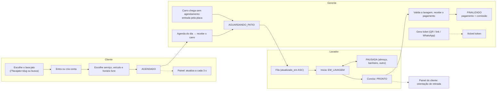

## 1. Primeira instalação e criação de um lava-jato

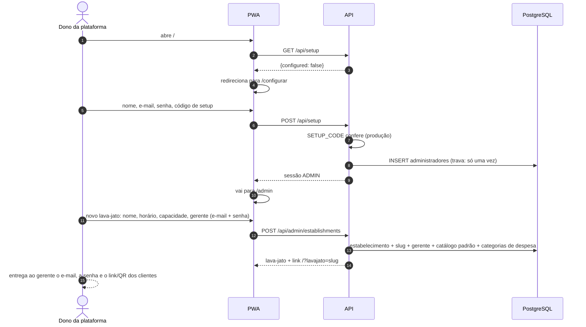

## 2. Cliente: escolha do lava-jato, cadastro e login

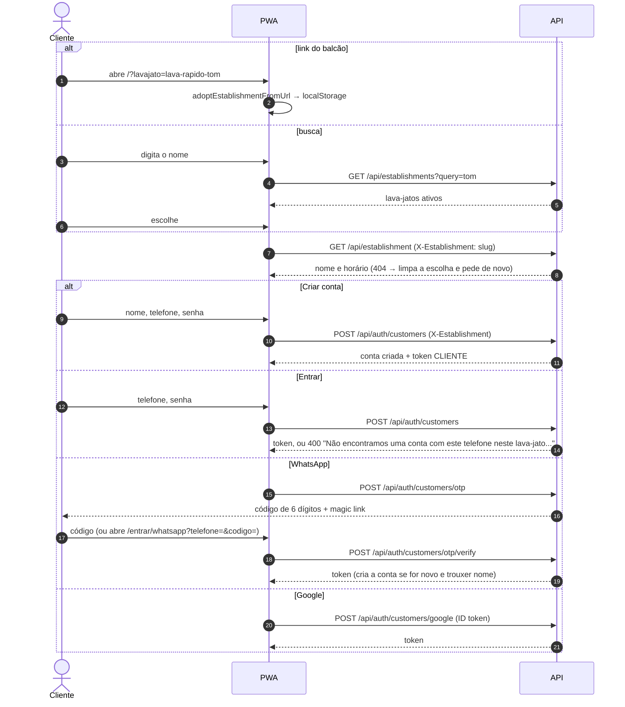

Se o mesmo cadastro for enviado duas vezes ao mesmo tempo, as duas respostas entram na mesma conta (o índice único barra a segunda conta e o caso de uso faz o login).

## 3. Login da equipe

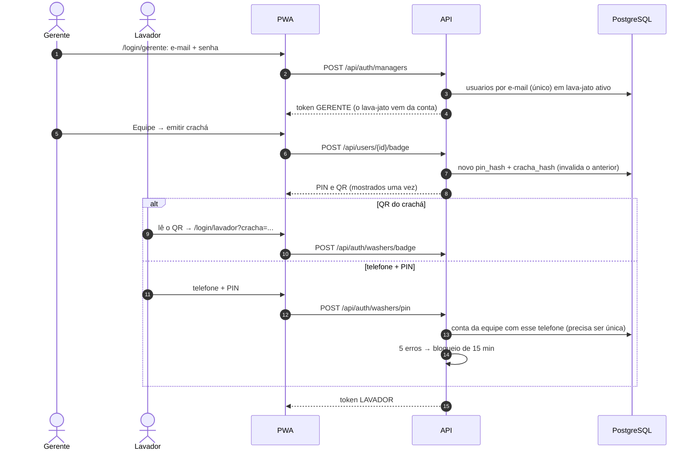

## 4. Entrada de veículo pela placa (balcão)

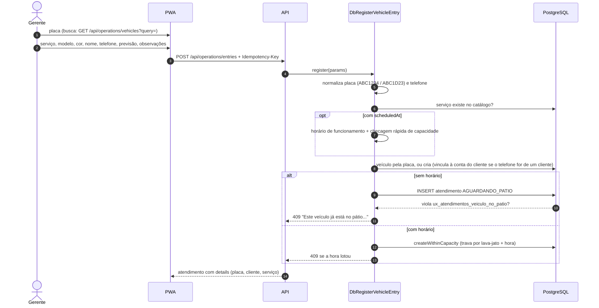

## 5. Agendamento com capacidade

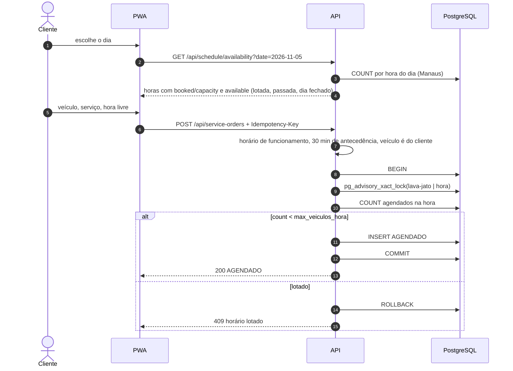

Pedidos simultâneos para a mesma hora passam pela trava um de cada vez, e a capacidade nunca é excedida. Horas diferentes ou lava-jatos diferentes não se bloqueiam.

## 6. Lavagem: iniciar, pausar, retomar, concluir

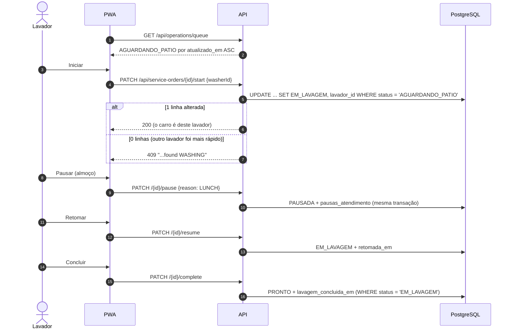

## 7. Receber e finalizar

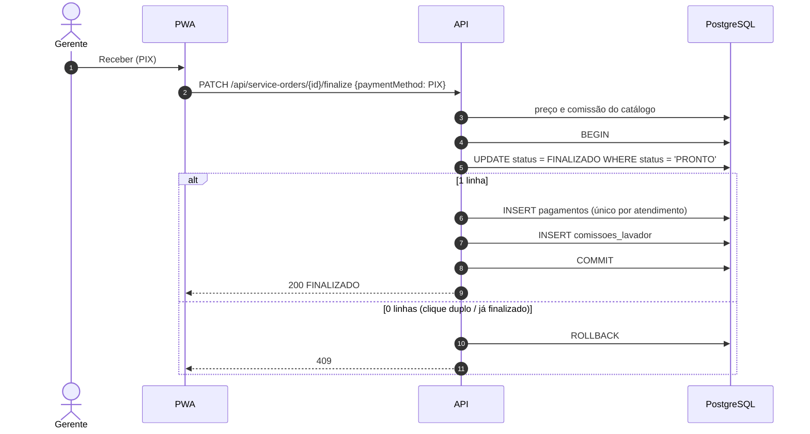

## 8. Ticket do cliente presencial

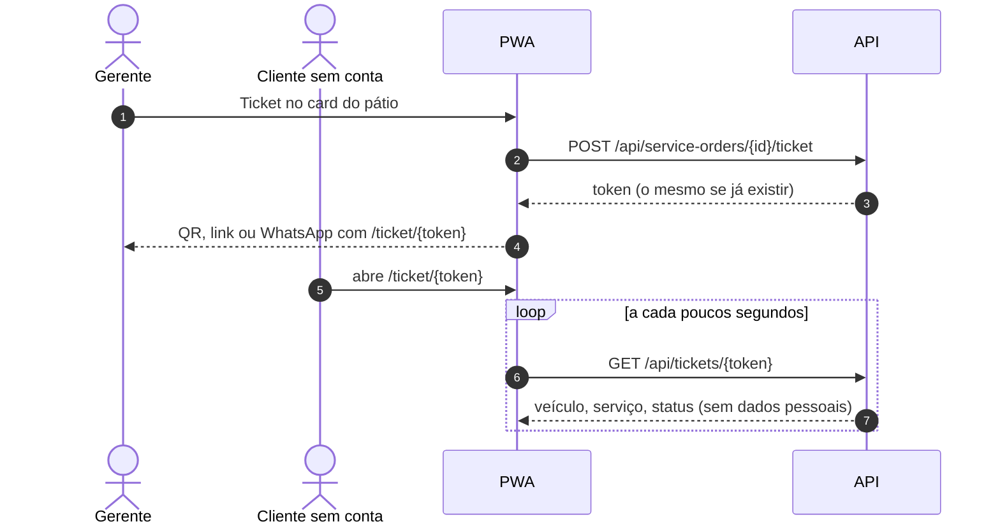

## 9. Venda rápida e orçamento, com reenvio seguro

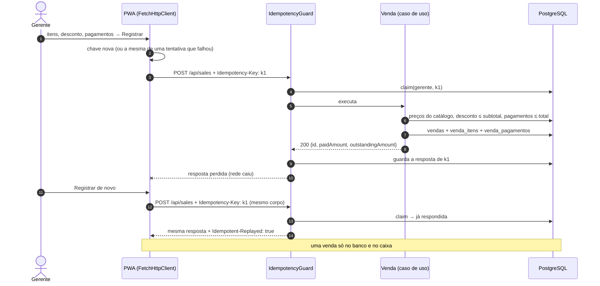

Um clique duplo nem chega a sair do navegador duas vezes: o `FetchHttpClient` reaproveita a requisição idêntica que ainda está em andamento.

## 10. Erro na tela → investigação

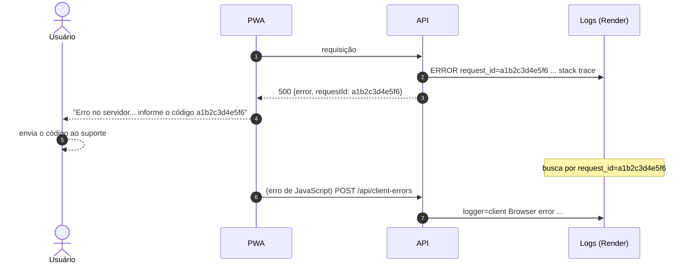
