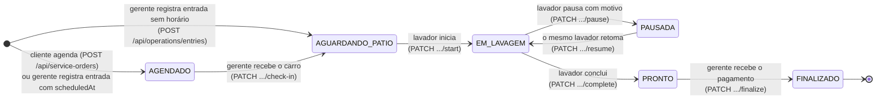

# Máquina de estados do atendimento

O campo `atendimentos.status` controla o ciclo de vida. A fila do pátio é ordenada por `atualizado_em ASC` (o primeiro que chega é o primeiro que sai).

## Transições

| De → para | Quem | Efeitos | Proteção contra corrida |
|---|---|---|---|
| — → `AGENDADO` | Cliente (o próprio veículo) ou gerente | Valida horário de funcionamento, antecedência mínima (30 min para o cliente), domingo e capacidade da hora | Contagem e inserção atômicas por lava-jato e hora (`createWithinCapacity`) |
| — → `AGUARDANDO_PATIO` | Gerente | Placa nova cria o veículo. Telefone de cliente cadastrado vincula a conta; senão vira contato do veículo | Índice `ux_atendimentos_veiculo_no_patio`: placa já no pátio → 409 |
| `AGENDADO` → `AGUARDANDO_PATIO` | Gerente | O carro entra na fila | `UPDATE ... WHERE status = 'AGENDADO'` + índice do pátio |
| `AGUARDANDO_PATIO` → `EM_LAVAGEM` | Lavador | Grava `lavador_id` e `lavagem_iniciada_em` | `UPDATE ... WHERE status = 'AGUARDANDO_PATIO'`: com dois lavadores, só um consegue (o outro recebe 409) |
| `EM_LAVAGEM` → `PAUSADA` | Lavador dono da lavagem | Abre registro em `pausas_atendimento` (motivo; descrição obrigatória para `OTHER`) | `UPDATE ... WHERE lavador_id = :eu AND status = 'EM_LAVAGEM'` |
| `PAUSADA` → `EM_LAVAGEM` | O mesmo lavador | Fecha a pausa (`retomada_em`) | `UPDATE ... WHERE status = 'PAUSADA'` na mesma transação |
| `EM_LAVAGEM` → `PRONTO` | Lavador | Grava `lavagem_concluida_em`. O painel do cliente mostra a orientação de retirada | `UPDATE ... WHERE status = 'EM_LAVAGEM'` |
| `PRONTO` → `FINALIZADO` | Gerente | **Em uma transação:** status, pagamento (valor do catálogo, nunca do cliente) e comissão do lavador | `UPDATE ... WHERE status = 'PRONTO'` + `pagamentos.atendimento_id` único: clique duplo gera um pagamento só |

Qualquer transição a partir de um status diferente do esperado responde **409** (`InvalidServiceOrderStatusError`). Isso vale tanto para o carro que já estava em outro status quanto para quem perdeu uma corrida.

## Leituras por status

| Tela | Consulta |
|---|---|
| Fila do lavador (`/api/operations/queue`) | `AGUARDANDO_PATIO`, `atualizado_em ASC` |
| Minhas lavagens (`/api/operations/my-orders`) | `EM_LAVAGEM` ou `PAUSADA` do lavador autenticado |
| Pátio do gerente (`/api/operations/yard`) | Tudo menos `FINALIZADO`, na ordem `EM_LAVAGEM`/`PAUSADA` → `AGUARDANDO_PATIO` → `PRONTO` → `AGENDADO` |
| Agenda (`/api/operations/agenda`) | Por data Manaus de agendamento, qualquer status (máx. 62 dias) |
| Painel do cliente | Atendimentos dos veículos do cliente, atualizados a cada 3 s |
| Ticket público (`/api/tickets/{token}`) | Veículo, serviço e status, sem dados do cliente |

## Relatórios

`GET /api/operations/report` considera atendimentos com pagamento no período (data Manaus). Ele soma faturamento, comissões, serviços, formas de pagamento e pausas por motivo, e calcula o tempo médio de lavagem (`concluída − iniciada − pausas`).
