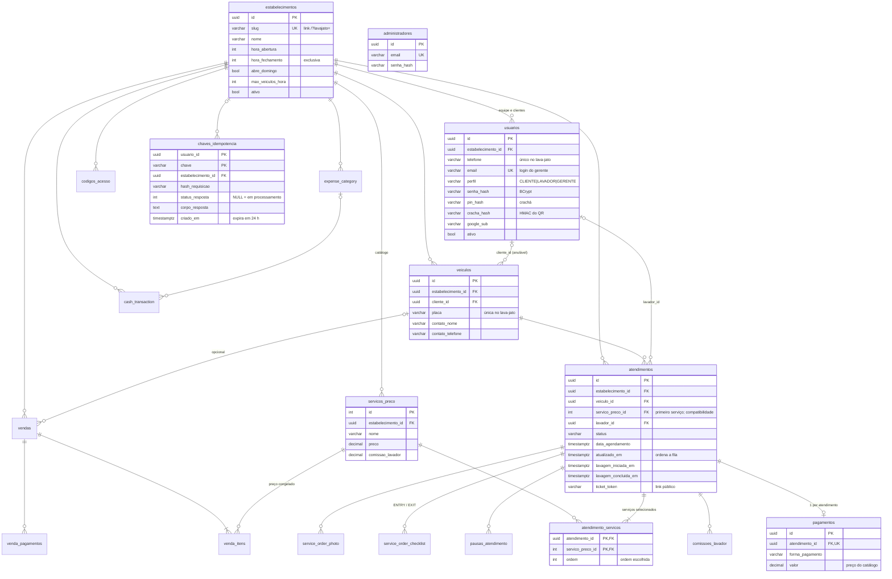

# Modelo de dados

PostgreSQL. O esquema é criado pelas migrações em `src/main/resources/db/migration`, aplicadas pelo Flyway (`JdbiFactory.migrate`, histórico em `schema_history`). O dicionário campo a campo está em [CLAUDE.md](../../CLAUDE.md), seção 2.

## Diagrama entidade-relacionamento

Tabelas não detalhadas no diagrama: `comissoes_lavador`, `pausas_atendimento` (motivo `LUNCH|RESTROOM|OTHER`), `service_order_checklist` (um por atendimento e tipo), `service_order_photo`, `expense_category`, `cash_transaction` (`INCOME|EXPENSE`), `vendas` (`VENDA|ORCAMENTO`), `venda_itens`, `venda_pagamentos` e `codigos_acesso` (só o hash do código de WhatsApp).

## Restrições que carregam regras de negócio

| Restrição | Regra |
|---|---|
| `ux_atendimentos_veiculo_no_patio`: único em `veiculo_id` quando `status IN (AGUARDANDO_PATIO, EM_LAVAGEM, PAUSADA, PRONTO)` | Um carro só pode ter um atendimento aberto no pátio. Agendamentos futuros não contam |
| `pagamentos.atendimento_id` único | Um pagamento por atendimento, mesmo com clique duplo |
| `uq_checklist_atendimento_tipo` | Um checklist de entrada e um de saída por atendimento (regravar substitui) |
| Telefone, placa e `google_sub` únicos por `estabelecimento_id`; `email` único global | Isolamento entre lava-jatos e login do gerente por e-mail |
| `chaves_idempotencia` PK (`usuario_id`, `chave`) | Uma operação por chave e por usuário |
| `CHECK`s de horário (`hora_abertura < hora_fechamento`) e de capacidade (`max_veiculos_hora > 0`) | Configuração do lava-jato sempre válida |
| `venda_pagamentos.valor > 0`, `venda_itens.quantidade > 0` | Valores coerentes. A soma dos pagamentos não passa do total (validado no caso de uso) |

## Migrações

| Versão | Arquivo | O que faz |
|---|---|---|
| V1 | `V1__reset_legacy_schema.sql` | Remove, uma única vez, o esquema anterior à 1.5.0 (decisão do lançamento multi-lava-jato: dados descartados) |
| V2 | `V2__baseline.sql` | Esquema completo da plataforma multi-lava-jato |
| V3 | `V3__concurrency_and_idempotency.sql` | Índice de um atendimento aberto por veículo no pátio e tabela `chaves_idempotencia` |
| V4 | `V4__audit_trail.sql` | Trilha de auditoria |
| V5 | `V5__service_order_cancellation.sql` | Cancelamento de atendimentos |
| V6 | `V6__service_order_refunds.sql` | Estorno de atendimentos |
| V7 | `V7__sale_refunds.sql` | Estorno de vendas |
| V8 | `V8__single_platform_administrator.sql` | Administrador único da plataforma |
| V9 | `V9__multiple_services_per_service_order.sql` | Associação de um ou mais serviços a cada atendimento; migra os atendimentos existentes |

Para criar uma migração nova, use a próxima versão disponível e não altere as já aplicadas. O app e os testes rodam as mesmas migrações. **Atenção ao subir a V3:** se o banco tiver um carro com dois atendimentos abertos, o índice não é criado e o app não sobe; finalize um deles antes.

## Fuso horário

Datas são gravadas como `TIMESTAMP WITH TIME ZONE` (instantes). Tudo que é dia ou hora do negócio (agenda, horário de funcionamento, slots de capacidade, filtros de relatório, vendas e caixa por dia) é calculado em **`America/Manaus`** (UTC-4), independentemente do fuso do servidor ou do navegador.
