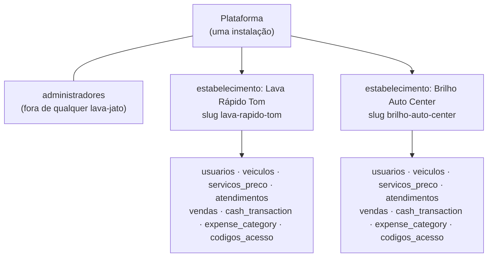
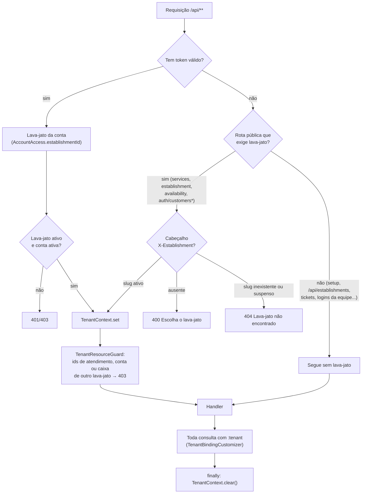
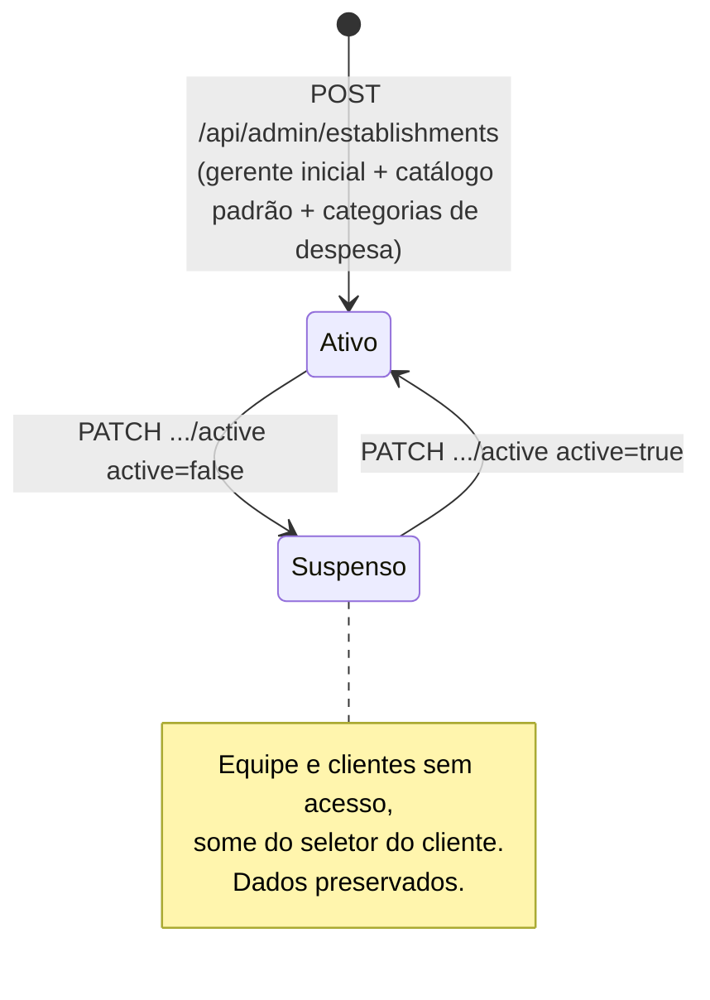

# Multi-tenant: vários lava-jatos em uma instalação

## Modelo

- Toda tabela operacional tem `estabelecimento_id`. As demais (pagamentos, comissões, pausas, checklist, fotos, itens e pagamentos de venda) pertencem ao lava-jato pelo atendimento ou pela venda.
- **Unicidade por lava-jato:** telefone, placa e conta Google. O mesmo cliente pode ter conta em dois lava-jatos, e a mesma placa pode existir nos dois.
- **Unicidade na plataforma:** `usuarios.email`. O e-mail identifica de qual lava-jato é o gerente.
- **Administrador da plataforma:** fica na tabela `administradores` e não pertence a nenhum lava-jato. Ele cria e suspende lava-jatos, mas **não acessa** dados operacionais.

## Como a requisição descobre o lava-jato

### Peças

| Peça | Papel |
|---|---|
| `TenantContext` (`data.tenancy`) | `ThreadLocal` com o lava-jato da requisição: `set`, `current`, `require`, `runAs`, `clear` |
| `AuthorizationMiddleware` | Resolve o lava-jato pelo token ou, nas rotas públicas do cliente, pelo cabeçalho `X-Establishment` |
| `TenantBindingCustomizer` (JDBI) | Antes de executar qualquer SQL que contenha `:tenant`, faz o bind com `TenantContext`. Sem lava-jato, lança `TenantRequiredError` (400). Assim, **esquecer o filtro vira erro, não vazamento** |
| `TenantResourceGuard` | Recusa (403) ids de atendimento, conta ou caixa que existem em outro lava-jato, antes do handler |
| `RequestTracing` | Limpa o `TenantContext` no `finally`, para a thread não carregar o lava-jato para a próxima requisição |

### Logins sem lava-jato no cabeçalho

A equipe não escolhe o lava-jato. Ele é identificado pela credencial:

| Login | Como identifica o lava-jato |
|---|---|
| Gerente: e-mail + senha | `usuarios.email` é único na plataforma |
| Lavador: QR do crachá | O hash HMAC do token do crachá aponta para a conta |
| Lavador: telefone + PIN ou senha | O telefone de conta da equipe com **correspondência única** entre lava-jatos ativos. Se o telefone for ambíguo, o login falha |
| Administrador | Tabela `administradores` (sem lava-jato) |

O cliente sempre escolhe o lava-jato antes, na tela inicial (busca por nome em `GET /api/establishments?query=` ou link `/?lavajato=slug` do balcão). O PWA envia a escolha em `X-Establishment`.

## Garantias e onde são testadas

| Garantia | Teste |
|---|---|
| Consultas de um lava-jato não retornam dados de outro | `EstablishmentIntegrationTest` |
| Ids de outro lava-jato → 403 | `AuthorizationMiddlewareTest` |
| Sem lava-jato → 400, slug inexistente ou suspenso → 404 | `AuthorizationMiddlewareTest` |
| Lavador de um lava-jato não entra em outro (crachá, PIN e telefone ambíguo) | Testes de acesso + verificação manual com os dados de demonstração |
| Suspender um lava-jato bloqueia equipe e clientes e preserva os dados | `EstablishmentIntegrationTest` |

## Ciclo de vida de um lava-jato

