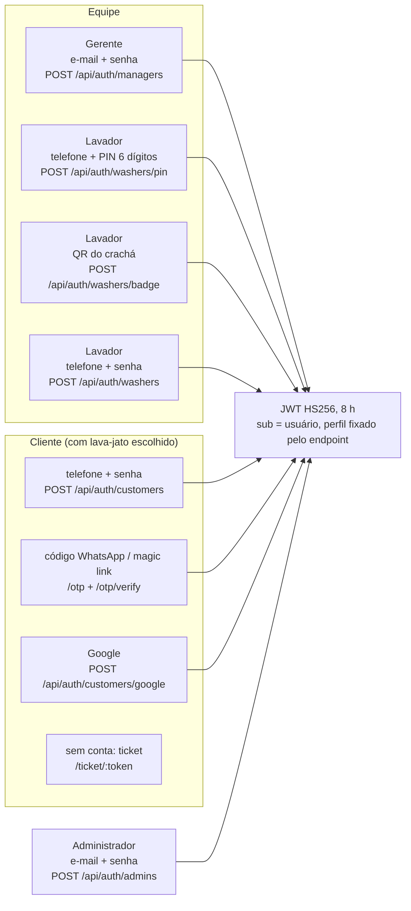
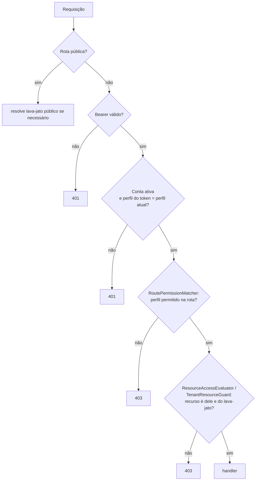

# Segurança e acesso

## Perfis

| Perfil | Pertence a | Pode |
|---|---|---|
| `ADMIN` | Plataforma (`administradores`) | Criar, listar, suspender e reativar lava-jatos (`/api/admin/**`). Não acessa dados de lava-jato |
| `GERENTE` (`MANAGER`) | Um lava-jato | Pátio, agenda, entradas, receber, finalizar, vendas, caixa, catálogo, equipe, crachás, tickets, checklist/fotos, configurações, relatórios |
| `LAVADOR` (`WASHER`) | Um lava-jato | Fila, iniciar, pausar, retomar e concluir **as próprias** lavagens |
| `CLIENTE` (`CUSTOMER`) | Um lava-jato | Os próprios veículos, agendar e acompanhar os próprios atendimentos |
| Público | — | Catálogo, horários livres, dados do lava-jato, seletor de lava-jatos, ticket por token, setup inicial, erros do navegador |

Somente clientes se cadastram publicamente. Contas de lavador são criadas pelo gerente. Um gerente pode mudar o perfil de contas do seu lava-jato, inclusive o próprio. Um lavador com lavagem em `EM_LAVAGEM` ou `PAUSADA` não pode ser desativado nem mudar de perfil.

## Formas de entrar

| Mecanismo | Detalhes |
|---|---|
| Senha | Mínimo 8 caracteres, BCrypt. Só o hash é persistido |
| Token | JWT HS256 assinado com `AUTH_TOKEN_SECRET` (≥ 32 caracteres em produção), validade de 8 h. O **perfil é fixado pelo endpoint de login**: entrar pelo login de lavador com uma conta de gerente falha |
| Verificação a cada requisição | Conta ativa, perfil atual igual ao do token e lava-jato ativo. Mudar o próprio perfil exige entrar de novo |
| Crachá do lavador | `POST /api/users/{id}/badge` gera PIN (BCrypt em `pin_hash`) e token de QR (HMAC em `cracha_hash`), mostrados **uma única vez**. Gerar de novo invalida o anterior. 5 PINs errados bloqueiam por 15 minutos |
| Código por WhatsApp | 6 dígitos, válido por 10 min, 5 tentativas, reenvio após 60 s. Só o hash fica em `codigos_acesso`. O link `/entrar/whatsapp?telefone=&codigo=` funciona como magic link. Hoje existe só o canal `log` (desenvolvimento): o envio real exige integrar um provedor em `AccessFactory.otpSender` |
| Google | Valida o ID token com `GOOGLE_CLIENT_ID` e liga `google_sub` à conta de cliente do lava-jato |
| Ticket | Token aleatório em `atendimentos.ticket_token`. Gerar de novo devolve o mesmo. Mostra veículo, serviço e andamento, sem nome nem telefone do cliente |
| Setup | `POST /api/setup` só funciona enquanto não existe administrador. Em produção, exige `SETUP_CODE` |

Contas da equipe nunca entram pelos caminhos do cliente (WhatsApp, Google, cadastro). Um telefone novo no login de equipe não cria conta.

## Autorização

- `RoutePermissionMatcher`: perfis aceitos por rota (por exemplo, `/api/admin/**` só para `ADMIN`).
- `ResourceAccessEvaluator`: o cliente só vê os próprios veículos e atendimentos, e o lavador só mexe nas lavagens atribuídas a ele.
- `TenantResourceGuard`: ids de outro lava-jato → 403.

## Proteções contra abuso e erros comuns

| Ameaça | Proteção |
|---|---|
| Força bruta no PIN | Bloqueio de 15 min após 5 erros |
| Força bruta no código WhatsApp | 5 tentativas por código, reenvio após 60 s |
| Inundação de `/api/client-errors` | 20 por minuto por IP; campos truncados antes do log |
| Métricas expostas | `/api/metrics` exige `METRICS_TOKEN`; sem a variável, responde 404 |
| Instalação "sequestrada" | Setup único + `SETUP_CODE` em produção |
| Valor adulterado no pagamento | Valor do serviço sempre vem do catálogo, nunca do corpo da requisição |
| Reenvio que duplica operação | `Idempotency-Key` (ver [confiabilidade.md](confiabilidade.md)) |
| Segredos no repositório | `.env` ignorado pelo git; em produção, `.env` não é lido |

## Pendências conhecidas

- O telefone do cliente só é verificado no login por WhatsApp, que ainda não tem provedor real.
- Contas antigas sem `senha_hash` só entram em desenvolvimento (em produção, exigem redefinição administrativa).
- Não há push com o app fechado: o cliente acompanha com o painel aberto ou pelo ticket.
